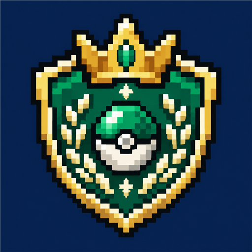

# More Cobblemon Contents: League Challenge

체육관 도전부터 배지·계급·사천왕·챔피언까지 이어지는 MCC 리그 애드온입니다.

## 주요 기능

- 별도의 리그 터미널과 GUI에서 진행하는 도전
- 체육관, 배지, 계급과 포켓몬 리그 진행
- 서버 데이터팩으로 정의하는 상대 팀과 보상
- PokeBadges 및 Cobbled Level Control을 통한 배지·레벨캡 연동
- 신오 일반 챔피언 승리 후 신오 하드·가라르 일반 해금, 가라르 일반 챔피언 승리 후 가라르 하드 해금
- 도전 레벨캡을 넘는 포켓몬은 전투용 복사본만 하향 보정하며 원본 파티의 레벨·경험치는 보존

물리적인 체육관 건물을 추가하는 방식이 아니라, 독립 터미널과 도전 화면으로 리그를 진행합니다.

## 설치

**클라이언트와 서버 양쪽에 설치합니다.** 싱글플레이에서도 같은 클라이언트 모드를 사용합니다.

| 항목 | 요구 사항 |
|---|---|
| Minecraft / Java | Java Edition 1.21.1 / Java 21 이상 |
| 로더 | Fabric Loader 0.19.5 이상 |
| 공통 필수 모드 | Fabric API, Fabric Language Kotlin 1.14.1+kotlin.2.4.20 이상, Cobblemon 1.8.1 이상 / 1.9.0 미만 |
| 기반 모드 | More Cobblemon Contents Core 0.1.0 이상 / 1.0.0 미만 |
| 추가 필수 모드 | PokeBadges, Cobbled Level Control 1.2.x |
| 선택 모드 | Mod Menu — 모드 목록 및 지원하는 설정 안내에 사용 |

1. 서버와 접속할 클라이언트의 `mods` 폴더에 모드 JAR과 필수 모드를 넣습니다. 필요한 지원 라이브러리는 각 의존 모드의 설치 안내를 따릅니다.
2. 본체와 사용하려는 애드온을 같은 구성으로 설치합니다. 애드온은 본체 없이 사용할 수 없습니다.
3. 플레이어는 `/mcc` 또는 콘텐츠의 홀로그램 터미널로 배틀 허브를 엽니다. 서버에서 해당 탭을 허용해야 접근할 수 있습니다.

## 설정과 콘텐츠 편집

**Mod Menu에 기존 설정 안내 화면이 있습니다.** 이 화면은 서버 규칙 편집기가 아니라 설정 위치를 설명하는 화면입니다.

- 서버 데이터팩의 `league-challenge/`에서 리그·상대 팀·보상 등 콘텐츠를 관리합니다.
- 레벨캡은 Cobbled Level Control의 숫자 단계와 리그 정의를 맞춰 관리합니다.
- 신오 외형은 기존 RCT Trainers+ 리소스팩에서 제공하며, 가라르 전용 픽셀 스킨 14종은 모드에 내장되어 있습니다.

지방 JSON(`league-challenge/leagues/*.json`)의 `active`를 `false`로 두면 해금 여부와 상관없이 그 지방 탭이 보이지 않고, 도전 요청도 받지 않으며, 레벨캡 계산에서도 빠집니다(기본값 `true`). 데이터와 진행도는 남아 관리자 명령으로는 확인할 수 있습니다. 기본 지방(`active.json`)은 끌 수 없습니다. 가라르는 공개 전이라 `false`로 배포합니다.

데이터팩 변경 후 관리자 권한으로 `/reload`를 실행합니다. 클라이언트에서 서버 레벨캡을 변경할 수 없으며, 진행 중인 연전의 팀을 즉시 교체하는 방식으로 사용하지 않습니다.

### 지방별 규칙과 화면

신오 일반 최초 도전은 모든 기믹이 잠깁니다. 신오 일반 챔피언을 이기면 월드의 기믹 잠금이 해제되며, 신오 리그 재도전·하드에서는 메가진화만 사용할 수 있습니다. 가라르 일반·하드에서는 다이맥스·거다이맥스만 사용할 수 있습니다. 도구·해당 폼 등 각 기믹의 기본 조건은 별도로 충족해야 합니다.

하드 리그는 배틀 시설처럼 같은 포켓몬(폼이 달라도 같은 종)과 같은 도구를 파티에 둘 이상 넣을 수 없습니다. 도구가 없는 포켓몬끼리는 상관없습니다. 도전을 시작할 때 검사하며, 결승은 시작한 파티로 끝까지 진행합니다.

가라르는 8단계·10명 관장으로 구성됩니다. 4단계는 채두/어니언, 6단계는 마쿠와/멜론 중 한 명을 이기면 다음 단계가 열립니다. 다른 관장도 도전할 수 있으며 최초 보상은 각각 받지만 배지 진행도는 단계당 한 번만 올라 최대 8입니다. 금랑 관장전만 더블배틀입니다. 두송도 이 콘텐츠에서는 다이맥스를 사용합니다.

챔피언컵은 사천왕·챔피언처럼 마리 → 호브 → 비트 → 금랑 → 단델의 5연전입니다. 연전은 엔트리를 고정하고 각 전투 사이에 전투용 파티를 완전히 회복하며, 연전 전체에 캡 하나를 씁니다.

결승이 열렸거나 진행 중이면 리그 탭 경로에 체육관 대신 결승 상대가 한 명씩 나옵니다. 신오의 사천왕·챔피언도 같습니다. 챔피언이 되면 다시 체육관 경로로 돌아갑니다.

가라르 일반 도전 캡은 신오처럼 상대 에이스 레벨 + 2이며, 단계별 22·24·30·36·39·43·46·52, 컵 64입니다. 팀 레벨은 신오 같은 단계에 맞췄고, 진화 레벨보다 낮아지는 경우에만 올려 두었습니다. 하드 관장전은 80, 하드 컵은 100입니다. 낮은 레벨은 올리지 않고 캡을 넘는 전투용 복사본만 내립니다. 클리어 보상은 월드의 성장·포획 캡을 각각 비교해 기존 캡보다 높을 때만 올리며, 낮추지 않습니다.

리그 내부는 `pixel_frame.tower_lobby`의 사각 프레임·회색 카드·제목 띠·버튼을 사용합니다. 허브 탭과 헤더의 공용 테마 설정은 바꾸지 않습니다. 상단 노드맵 아래의 3열은 상대 초상화/이름/도전 캡, 기믹별 V/X 체크리스트, 클리어 보상·해금 순서입니다. 현재 월드 캡 이하인 캡 보상은 표시하지 않습니다. 논리 GUI 427×240에서는 9단계가 모두 보이며, 320×240에서는 좌우 버튼으로 끝 단계까지 이동합니다. 노드에는 단계 번호와 클리어·잠금 표시가 있고 전체 상태 문구는 툴팁으로 확인합니다. 보상은 열 너비에 맞춰 줄바꿈하고 내용이 길면 해당 열 위에서 휠로 스크롤합니다.

관리자 명령의 기본 대상은 신오입니다. 가라르는 `/mcc league region galar inspect <플레이어>`, `/mcc league region galar progress set <플레이어> <도전 ID|all>`처럼 지정합니다. 진행도 초기화나 하향 설정도 외부 CLC 캡을 낮추지 않습니다. 실제 제한값을 내리려면 CLC 관리자 설정을 따로 사용해야 합니다.

가라르 음악은 음원 수령 전까지 전용 파일 없이 연결 키만 제공합니다. [필요 BGM 7종과 연결 키](../better-cobblemon-music/GALAR_MUSIC_INPUT.md)를 참고하세요. [일반·하드 엔트리](docs/GALAR_TEAMS.md)에서 원작 기준과 자체 조정 범위를 구분합니다.

### 야생 트레이너 스폰 위치

야생 트레이너는 사람이 설 만한 땅에만 나옵니다. 나뭇잎 위, 주변 지면보다 3칸 이상 높은 자리(나무줄기·기둥 꼭대기), 바로 옆 8칸 중 2칸 이상이 발 높이에서 한 칸 아래까지 비어 있는 자리(턱·절벽 끝)에는 스폰하지 않습니다. 벽과 물은 빈 칸으로 보지 않습니다.

### 야생 트레이너 파티

엘리트 트레이너(`tier: "ace"`)는 진행 단계와 관계없이 4~6마리를 사용합니다. 일반 트레이너는 1~6마리를 사용합니다. 파티는 도전할 때 생성하며, 포켓몬이 많을수록 레벨캡보다 낮게 배정하는 보정은 두 종류 모두 적용됩니다.

### 야생 포켓몬 레벨

32×32블록 구역마다 플레이어와 무관한 기준값 10~85가 정해집니다. 시작 구역은 10이고, 이동하면 기준값이 서서히 달라집니다. 2,048×2,048블록 권역마다 최고 기준값 85인 지역이 하나 이상 있습니다.

새 스폰은 `min(지역 기준값, 스폰을 일으킨 플레이어의 레벨캡)`에서 15~5 낮은 범위를 균등 추첨하고, 1보다 낮으면 1로 올립니다. 시작 지역의 실제 포켓몬은 1~5레벨이며, 최고 지역은 캡이 충분하면 70~80입니다. 야생 우두머리도 같은 범위 안으로 묶습니다. 지금 서 있는 구역의 값은 `/구역스폰레벨`로 확인할 수 있습니다. 기존 포켓몬의 레벨은 바뀌지 않습니다.

서버 데이터팩 `league-challenge/leagues/active.json`의 `wild_level`에서 조정합니다. 기본값은 `below_cap: 10`, `spread: 5`, `region_chunks: 2`, `region_min: 10`, `region_max: 85`, `transition_regions: 32`입니다. 이전 `floor_level` 필드는 제거해야 합니다. 자세한 계약과 설정은 [야생 레벨 V2](docs/WILD_SPAWN_LEVELS_V2.md)를 참고하세요.

## 문제 해결

- 모드가 로드되지 않으면 클라이언트·서버의 모드 구성과 필수 의존성을 확인하세요.
- 허브에 콘텐츠가 보이지 않으면 해당 애드온 설치 여부와 본체의 `hub_tabs.json` 설정을 확인하세요.
- 데이터팩을 수정한 뒤 문제가 생기면 서버 로그에서 잘못된 콘텐츠 정의를 확인하세요. 모드 JAR을 직접 수정하는 대신 서버 데이터팩을 사용합니다.

## 라이선스와 배포 설명

이 모드의 자체 코드와 아이콘은 [MIT License](LICENSE)로 제공합니다. 의존 모드와 내장 라이브러리는 각각의 라이선스를 따릅니다.

공개 배포 페이지용 영문 설명은 [MODRINTH.md](MODRINTH.md)에 있습니다. [소스](https://github.com/taku7664/Minecraft-Cobblemon-Mods/tree/main/works/mods/more-cobblemon-contents-league-challenge) · [문제 신고](https://github.com/taku7664/Minecraft-Cobblemon-Mods/issues)
